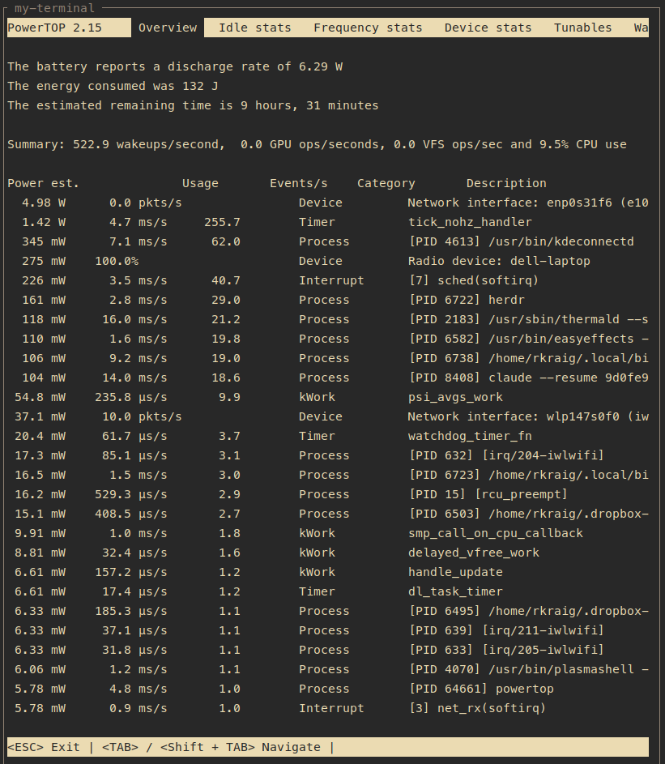
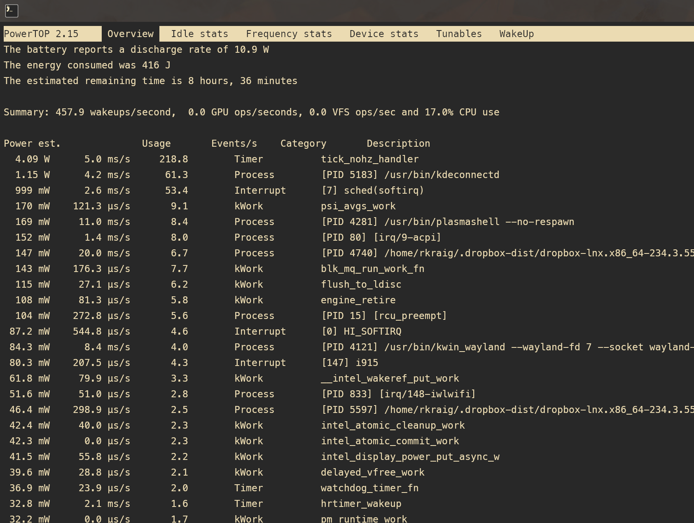

# ubuntu-fixes

Ubuntu 26.04 ships with several power management problems that make a modern
laptop run hot, drain fast, and lose WiFi after sleep. This repo fixes them —
and in doing so, lays a proper foundation for a high-performance developer
machine on KDE Plasma 6 / Wayland.

The two goals reinforce each other: a machine that isn't fighting its own
hardware has more headroom for development work, better battery life during
travel, and a desktop that actually behaves like the hardware it runs on.

## What this fixes

**Power management** — Ubuntu's defaults leave significant wattage on the
table. These fixes bring idle battery draw from ~20–25W down to ~6W on a
Precision 7560, without sacrificing performance on AC:

- Replace `power-profiles-daemon` with TLP for real per-subsystem tuning
- Suspend the NVIDIA GPU when not in use (17W → 0W at idle)
- Silence ACPI GPE interrupt storms that prevent deeper C-states
- Disable KDE compositor effects on battery, restore on AC
- Cap CPU power when lid is closed on AC (prevents sustained ~77°C+ heat)
- Disable Docker bridge interfaces that drain ~8W when idle

**Hardware reliability** — issues that make the machine unusable after sleep:

- Intel WiFi BE200/AX210 hanging after suspend/resume, including PCI bus
  wedge recovery (`HW_REV=0xFFFFFFFF`) that a simple module reload can't fix
- Plasma battery widget breaking after TLP install (service ordering fix)

**Developer foundation** — once power is stable, the machine is a clean
base for development. The fixes are surgical and self-contained; nothing
installs globally beyond what each fix declares.

## Quick start

```bash
git clone https://github.com/robertkraig/ubuntu-fixes
cd ubuntu-fixes
make help       # what's here and why
make list       # what applies to this machine
make all        # run everything interactively
```

Or deploy one fix directly:

```bash
make wifi-sleep-resume
make tlp-battery
```

## Results

| Machine | Idle draw before | After |
|---|---|---|
| Precision 7560 (Tiger Lake, RTX A2000, WiFi 7 BE200) | ~20–25W | **~6.3W** |
| Precision 7510 (Skylake, Quadro M2000M, 4K panel) | ~24W | **~10.9W** |





## Fixes

| Fix | Problem solved | Detects |
|---|---|---|
| `tlp-battery` | Replace `power-profiles-daemon` with TLP; add Plasma profile slider | Intel/AMD pstate laptop |
| `nvidia-power` | NVIDIA GPU draws 17W at idle on hybrid Optimus | hybrid GPU + nvidia driver |
| `acpi-gpe-storm` | Firmware bug fires ACPI GPE ~1500×/sec, blocking deep sleep | GPE over 100/s |
| `kde-battery-effects` | KWin blur/wobble/animations drain power on battery | KDE Plasma |
| `kdeconnect-remove` | `kdeconnectd` wakes the CPU ~60×/s (~1W) and restarts itself via D-Bus | KDE Connect installed |
| `lid-close-power` | CPU runs uncapped with lid closed on AC → sustained 77°C+ heat | lid button + TLP |
| `wifi-sleep-resume` | Intel WiFi hangs after resume; handles PCI bus wedge state | iwlwifi |
| `docker-autostart` | Docker + containers silently running at boot, ~8W idle drain | Docker enabled at boot |
| `powerdevil-tlp-ordering` | Plasma battery widget not showing TLP power profile controls | Plasma + tlp-pd |
| `shell-power-status` | No quick way to see the power profile, battery draw and GPU state | laptop (battery) |
| `claude-memory` | Claude Code memory files for this machine's workflow | memories not installed |

## Tested on

| Machine | CPU | GPU | WiFi |
|---|---|---|---|
| Dell Precision 7560 | Intel i7-11850H (Tiger Lake-H) | NVIDIA RTX A2000 Mobile | Intel WiFi 7 BE200 |
| Dell Precision 7510 | Intel i7-6820HQ (Skylake-H) | NVIDIA Quadro M2000M | Intel AX210 |

## Contributing

If you have a fix for a power, hardware reliability, or developer setup issue
on Ubuntu + KDE Plasma — open a PR. The bar is low: a working `install.sh`,
an `applies.sh` that correctly detects whether the fix is needed, and a
one-paragraph README explaining the problem and what the fix does.

Not ready for a full fix? A PR that just adds a link to another repo or
upstream issue that covers the same ground is also welcome — the goal is
for this to be a useful reference, not a walled garden.

If you're working from a similar repo, feel free to link it here or open an
issue to discuss merging approaches.

## Design

Each fix is self-contained under `fixes/<name>/`:

- `applies.sh` — exits `0` (applies), `1` (not applicable), `2` (already applied)
- `install.sh` — deploys files, enables services, reloads udev
- Source files for everything deployed (services, udev rules, scripts)

Deployed files are hash-checked against their source templates. If a file on
disk differs from the repo, `make list` shows it as stale and re-running the
fix redeploys it. No fix touches another fix's files.

### Writing a fix

- `install.sh` runs as root by default. Add `# Run as your regular user` on
  line 2 if it edits `$HOME` or calls sudo itself.
- `applies.sh` runs as the user; print a one-line reason to stdout before
  exiting.
- Source template files using `lib/deploy.sh` helpers (`deploy_file`,
  `deploy_template`, `file_current`, `deployed_and_current`).
- Deployed scripts that run on their own (udev, acpid, systemd hooks) must log
  to the journal so failures can be debugged after the fact. Put this right
  after the header comment, then `echo` each decision with the values it acted
  on (before/after):

  ```bash
  exec > >(logger -t ubuntu-fixes/<name>) 2>&1
  ```

  Log each setting a script touches as one line, `changed: <what> <before> -> <after>`
  or `unchanged: <what> ...` with the reason, so changes are easy to filter.

  View one script with `journalctl -t ubuntu-fixes/<name>`, all of them with
  `journalctl -b | grep ubuntu-fixes/`, or only changes with `-g changed:`.
